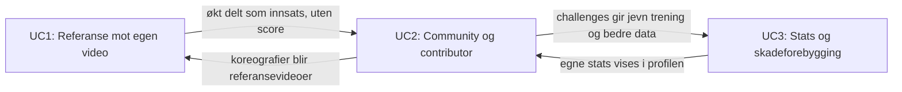

# Use case 2: Community og contributor (mitt ansvar)

Kobling mot [konsept.md](konsept.md) og [use-cases.md](use-cases.md).

## Beskrivelse
- Individuell contributor i eget univers, eller sammen med venner og studio
- Progresjonen din kan sammenlignes med andre
- Challenges som kan gjennomføres sammen med andre

## Beslutninger

| Tema | Beslutning |
|---|---|
| Fokus i demo | Eget univers + vennegruppe |
| Hva sammenlignes | Innsats og fremgang (timer, streak, nye steg). Ikke kvalitetsscore |
| Challenges | Felles mål for gruppen, f.eks. «Vi danser 50 timer sammen denne uka» |
| Contributor | Laste opp koreografi, dele økter, heie på andre, hjelpe andre |
| Tydeligste kobling | UC2 → UC1: koreografier fra community blir referansevideoer i UC1 |

## Brukerreise (demo-flyt for UC2)
1. Brukeren har et **eget univers** (profil med timer, streak, nye steg).
2. Hun oppretter eller blir med i en **vennegruppe** (eller studio-space).
3. Gruppen har en **felles challenge**, og alles økter bidrar mot målet.
4. En venn **laster opp en koreografi**. Den dukker opp som referansevideo i UC1.
5. Brukeren danser den mot referansen (UC1) og deler innsatsen, ikke scoren.
6. Gruppen **heier** på hverandre og feirer når målet nås.

## Funksjoner

### Eget univers
- Personlig profil og tidslinje
- Innsats: timer, streak, nye steg
- Valg av hva som er synlig for hvem (privat som standard)

### Vennegruppe og studio
- Opprette gruppe, invitere venner, koble til studio
- Gruppeside med felles mål og aktivitet
- «Andre som deg»: samme studio, samme stil i samme område, keen på å øve sammen (neste steg)

### Sammenligning uten toxic
- Viser vekst og innsats, ikke score
- «Din forbedring denne måneden» ved siden av gruppens felles fremgang
- Ingen rangering eller leaderboard

### Challenges
- Felles mål der alle bidrar
- Trend-challenge: «Prøv en dance challenge, kom og dans med oss senere»
- Alle som deltar teller, uansett nivå

### Contributor
- Last opp egen koreografi (referansevideo til UC1)
- Del økt som innsats
- Heie (reaksjoner) og hjelpe (tips til nybegynnere)
- Blest til dem som bidrar og deler, ikke til dem som er flinkest

## Linjer til UC1 og UC3

| Kobling | Hva UC2 får / gir |
|---|---|
| UC2 → UC1 | Bidratte koreografier blir referansevideoer. Dette er den tydeligste koblingen og vises i demoen |
| UC1 → UC2 | Økter kan deles som innsats («lærte nytt move»), score forblir privat |
| UC3 → UC2 | Stats over tid vises i profil og gruppe, med brukerens samtykke |
| UC2 → UC3 | Challenges kan inkludere skadeforebygging, f.eks. «hviledag» eller «oppvarming» som del av målet |

## Åpne spørsmål
- Hva skjer hvis en koreograf laster opp noe de ikke eier (opphavsrett til musikk og koreografi)?
- Moderering: hvordan holder vi kommentarer og videoer trygge, særlig om barn kommer med senere?
- Hva er det minste vi må bygge for UC2 i en 3-minutters demo? (forslag: profil + gruppe + felles challenge + én opplastet koreografi som dukker opp i UC1)
- Hvordan teller en økt mot challenge: manuelt logget, eller automatisk fra UC1?
