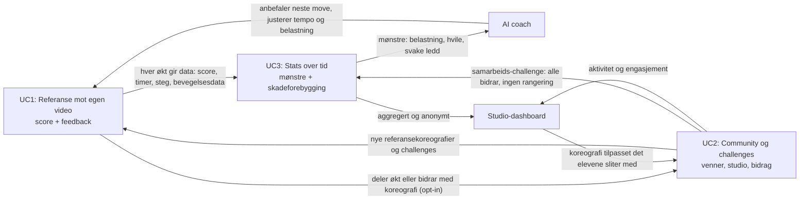

# Use cases og hvordan de henger sammen

Kobling mot [konsept.md](konsept.md). Use case 1 er demo-kjernen. 2 og 3 bygger videre på dataene fra 1.

## Use case 1: Referansevideo mot egen video
- Sammenlign egen video med referansevideo
- Growth mindset: forbedre deg over tid, ikke bli dømt
- Kan gjelde ett enkelt move eller en hel koreografi
- Scoring og feedback

## Use case 2: Contributor og community
- Individuell contributor i eget univers, eller sammen med venner og studio
- Progresjonen din kan sammenlignes med andre
- Challenges som kan gjennomføres mot andre

## Use case 3: Stats over tid og skadeforebygging
- Stats over tid
- Hva er viktig for brukeren å tracke?
- Skadeforebygging: finnes det mønstre i dansingen over tid?

## Diagram: hvordan use casene mater hverandre

## Der use casene svarer bedre sammen

| Fra | Til | Hva det gir |
|---|---|---|
| UC1 → UC3 | Hver økt gir målepunkter | Score, tid og bevegelsesmønstre blir råmaterialet til stats over tid |
| UC3 → UC1 | Stats styrer feedback | Feedbacken blir personlig: «Du har forbedret deg 12 % på dette moveet siden sist» |
| UC3 → AI coach | Mønstre gir råd | Coachen oppdager f.eks. at du alltid kompenserer med høyre kne, og foreslår hvile eller tilpasning |
| UC2 → UC1 | Community gir innhold | Referansevideoer kommer fra venner, studio og influencere, ikke bare et fast bibliotek |
| UC1 → UC2 | Økter blir delbare | «Jeg lærte dette moveet i dag» deles som innsats, ikke som score |
| UC2 → UC3 | Challenges gir motivasjon | Ukentlige samarbeids-challenges gir jevnere trening og bedre data |
| UC3 → Studio | Aggregert innsikt | «Mange sliter med turn-sekvensen» fører til bedre undervisning |

## Spenning vi må avklare
UC2 sier at progresjon «kan sammenlignes med andre» og at challenges kan gjøres «mot andre». Det kolliderer med prinsippene vi satte i konseptet: ingen rangering, privat score og deling av innsats, ikke prestasjon.

Forslag til løsning:
- Sammenligning mellom brukere gjelder innsats og vekst (f.eks. «din forbedring», ikke «din score»).
- Challenges gjøres sammen med andre: gruppemål der alle bidrar, ikke førsteplass.
- Direkte score-sammenligning kun i lukket vennegruppe og kun hvis alle har sagt ja.

## Skadeforebygging (UC3): hva kan tracks?
Hypoteser å teste, uten å love medisinsk presisjon:
- Treningsvolum: timer per uke, plutselige økninger, manglende hvile
- Bevegelseskvalitet: vinkler og asymmetri mellom venstre og høyre side
- Fall i kvalitet utover en økt, som tegn på tretthet
- Selvrapporterte vondter før og etter økt, koblet mot move eller stil
- Repetisjon: samme belastende move mange ganger på kort tid

Disse kan gi råd som «ta en rolig dag» eller «varm opp skuldrene». Det er ikke diagnoser.

## Åpne spørsmål
- Hvilke 3–5 ting er viktigst for brukeren å tracke i MVP? (forslag: timer, score-utvikling, nye steg, egenrapportert ømhet)
- Hvor mye skal UC2 og UC3 med i 3-minutters demoen, eller bare vises som «neste steg» på en slide?
- Kan pose estimation gi nok nøyaktighet til asymmetri og tretthet?
